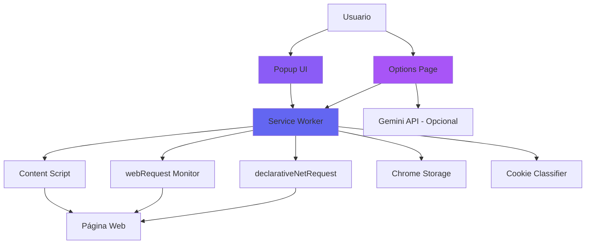

# Ghost Cookie - Documentación Completa del Proyecto

## 📋 Tabla de Contenidos

1. [Resumen del Proyecto](#resumen-del-proyecto)
2. [Estructura del Proyecto](#estructura-del-proyecto)
3. [Arquitectura](#arquitectura)
4. [Componentes Principales](#componentes-principales)
5. [Funciones Detalladas](#funciones-detalladas)
6. [APIs y Permisos](#apis-y-permisos)
7. [Flujo de Datos](#flujo-de-datos)
8. [Instalación y Configuración](#instalación-y-configuración)

---

## 🎯 Resumen del Proyecto

**Ghost Cookie** es una extensión de navegador Chrome que protege la privacidad del usuario mediante:

- **Bloqueo de trackers**: Detecta y bloquea más de 50 trackers conocidos
- **Bloqueo de anuncios de YouTube**: Bloquea y salta automáticamente anuncios en videos de YouTube
- **Gestión de cookies**: Visualiza, clasifica y elimina cookies
- **Score de privacidad**: Calcula un score de 0-100 basado en trackers y cookies
- **Clasificación inteligente**: Categoriza cookies automáticamente (Esencial, Funcional, Tracking, Publicidad)
- **Integración opcional con IA**: Soporte para Gemini API para análisis avanzado

### Tecnologías Utilizadas

- **Manifest V3**: Última versión de extensiones de Chrome
- **JavaScript ES6+**: Módulos, async/await, arrow functions
- **Chrome APIs**: declarativeNetRequest, webRequest, cookies, storage, tabs
- **CSS3**: Variables CSS, gradients, animations, flexbox, grid

---

## 📁 Estructura del Proyecto

```
plugin_browser/
├── manifest.json                 # Configuración principal de la extensión
├── icons/                        # Iconos de la extensión
│   ├── icon16.png               # 16x16 - Favicon
│   ├── icon32.png               # 32x32 - Barra de herramientas
│   ├── icon48.png               # 48x48 - Página de extensiones
│   └── icon128.png              # 128x128 - Chrome Web Store
├── popup/                        # Interfaz principal (popup)
│   ├── popup.html               # Estructura HTML del popup
│   ├── popup.css                # Estilos del popup (incluye YouTube indicator)
│   └── popup.js                 # Lógica del popup (ES6 module)
├── background/                   # Scripts de fondo
│   ├── service-worker.js        # Service worker principal
│   └── tracker-list.js          # Base de datos de trackers
├── content/                      # Scripts inyectados en páginas
│   ├── content.js               # Detector de trackers inline
│   └── youtube-adblocker.js     # Bloqueador específico de YouTube (NUEVO v1.1.0)
├── options/                      # Página de configuración
│   ├── options.html             # Interfaz de opciones
│   ├── options.css              # Estilos de opciones
│   └── options.js               # Lógica de configuración
├── utils/                        # Utilidades compartidas
│   └── cookie-classifier.js     # Clasificador de cookies
└── rules/                        # Reglas de bloqueo
    └── tracker_rules.json       # Reglas declarativeNetRequest (40 reglas)
```

---

## 🏗️ Arquitectura

### Diagrama de Componentes



### Flujo de Comunicación

1. **Popup ↔ Service Worker**: `chrome.runtime.sendMessage()`
2. **Content Script → Service Worker**: `chrome.runtime.sendMessage()`
3. **Service Worker → Storage**: `chrome.storage.local`
4. **Service Worker → Network**: `chrome.webRequest`, `chrome.declarativeNetRequest`

---

## 🧩 Componentes Principales

### 1. Manifest.json

**Propósito**: Configuración central de la extensión

**Permisos solicitados**:

- `cookies`: Leer y eliminar cookies
- `storage`: Guardar configuración y estadísticas
- `activeTab`: Acceder a la pestaña activa
- `tabs`: Información de pestañas
- `webRequest`: Monitorear requests de red
- `declarativeNetRequest`: Bloquear trackers
- `declarativeNetRequestFeedback`: Debug de bloqueos
- `<all_urls>`: Acceso a todos los sitios

**Componentes declarados**:

- `action`: Popup principal
- `background`: Service worker
- `content_scripts`: Scripts inyectados
- `options_page`: Página de configuración
- `declarative_net_request`: Reglas de bloqueo

---

### 2. Service Worker (background/service-worker.js)

**Propósito**: Cerebro de la extensión, maneja la lógica de bloqueo y detección

#### Estado Global

```javascript
const state = {
  protectionEnabled: true, // Toggle de protección
  blockedTrackers: {}, // { domain: count }
  detectedTrackers: {}, // { domain: [tracker objects] }
  networkBlocks: {}, // { domain: count }
};
```

#### Funciones Principales

##### `detectTrackerFromUrl(url)`

- **Entrada**: URL de un request
- **Salida**: `{ name, category, url }` o `null`
- **Propósito**: Identifica si una URL pertenece a un tracker conocido
- **Algoritmo**: Compara URL contra 50+ patrones de trackers

##### `handleToggleProtection(enabled)`

- **Entrada**: `boolean` - estado de protección
- **Salida**: Actualiza reglas de bloqueo
- **API usada**: `chrome.declarativeNetRequest.updateEnabledRulesets()`

##### `handleTrackerDetected(domain, tracker)`

- **Entrada**: Dominio del sitio y objeto tracker
- **Salida**: Actualiza estado y storage
- **Side effects**: Actualiza badge, guarda en storage

##### `updateBadge(domain)`

- **Entrada**: Dominio del sitio
- **Salida**: Actualiza badge del icono
- **Lógica**:
  - Si protección ON + trackers > 0: Muestra número en rojo
  - Si protección OFF: Muestra "OFF" en gris
  - Si no hay trackers: Badge vacío

#### Listeners

**webRequest.onBeforeRequest**

```javascript
chrome.webRequest.onBeforeRequest.addListener(
  (details) => {
    // Detecta trackers en tiempo real
    // Actualiza estadísticas
    // Actualiza badge
  },
  { urls: ["<all_urls>"] }
);
```

**runtime.onMessage**

```javascript
// Maneja mensajes de:
// - Popup (getTrackers, getStats, toggleProtection)
// - Content script (trackerDetected)
```

**tabs.onActivated / tabs.onUpdated**

```javascript
// Actualiza badge cuando cambias de pestaña
// Limpia stats en nueva navegación
```

---

### 3. Popup (popup/popup.js)

**Propósito**: Interfaz de usuario principal

#### Inicialización

```javascript
document.addEventListener("DOMContentLoaded", () => {
  initTabs(); // Sistema de pestañas
  initToggle(); // Toggle de protección
  initCookieManager(); // Botones de eliminar cookies
  loadCurrentSite(); // Muestra dominio actual
  loadSettings(); // Carga configuración
  loadStats(); // Carga estadísticas
  loadTrackers(); // Lista de trackers
  loadCookies(); // Lista de cookies

  // Auto-refresh cada 2 segundos
  setInterval(() => {
    loadStats();
    loadTrackers();
  }, 2000);
});
```

#### Funciones de UI

##### `initTabs()`

- **Propósito**: Maneja navegación entre pestañas (Trackers/Cookies)
- **Eventos**: Click en botones de pestaña
- **Efecto**: Muestra/oculta paneles con animación

##### `loadStats()`

- **Propósito**: Carga y muestra estadísticas
- **Flujo**:
  1. Obtiene pestaña activa
  2. Solicita stats al service worker
  3. Cuenta cookies con `chrome.cookies.getAll()`
  4. Calcula privacy score
  5. Actualiza UI

##### `updatePrivacyScore(scoreData)`

- **Entrada**: `{ score, rating, color, emoji }`
- **Propósito**: Renderiza el score de privacidad
- **Elementos actualizados**:
  - Emoji (🛡️/✅/⚠️/🚨)
  - Rating (Excelente/Bueno/Moderado/Bajo)
  - Barra de progreso
  - Valor numérico

##### `loadCookies()`

- **Propósito**: Lista todas las cookies del sitio
- **Características**:
  - Clasificación automática (si está habilitada)
  - Badges de categoría con iconos
  - Botón de eliminar individual
  - Animación de eliminación

---

### 4. Content Script (content/content.js)

**Propósito**: Detecta trackers inline en páginas web

#### Funciones de Escaneo

##### `scanInlineScripts()`

- **Propósito**: Busca código de tracking en scripts inline
- **Patrones detectados**:
  - `gtag()` - Google Analytics
  - `fbq()` - Facebook Pixel
  - `_hj()` - Hotjar
  - `mixpanel.track()` - Mixpanel
  - Y más...

##### `scanExternalScripts()`

- **Propósito**: Detecta scripts externos de tracking
- **Método**: Analiza atributo `src` de tags `<script>`

##### `scanTrackingPixels()`

- **Propósito**: Detecta píxeles de tracking (imágenes 1x1)
- **Criterios**: `width="1"`, `height="1"`, `display:none`

##### `observeDynamicContent()`

- **Propósito**: Monitorea contenido añadido dinámicamente
- **API**: `MutationObserver`
- **Trigger**: Cuando se añaden nuevos `<script>` o ``

---

### 4. YouTube Ad Blocker (content/youtube-adblocker.js) **[NUEVO v1.1.0]**

**Propósito**: Bloquea y salta automáticamente anuncios en YouTube

#### Características Principales

##### Bloqueo de Anuncios

- **Pre-roll ads**: Anuncios antes del video
- **Mid-roll ads**: Anuncios durante el video
- **Post-roll ads**: Anuncios después del video
- **Banner ads**: Anuncios en la sidebar
- **Overlay ads**: Anuncios superpuestos en el video
- **Sponsored content**: Contenido promocionado

##### Técnicas de Bloqueo

**1. Inyección de CSS**

```javascript
function injectAdBlockCSS() {
  const style = document.createElement("style");
  style.textContent = `
    .video-ads, .ytp-ad-module, 
    ytd-display-ad-renderer { display: none !important; }
  `;
  document.head.appendChild(style);
}
```

**2. Eliminación del DOM**

```javascript
function removeAdElements() {
  AD_SELECTORS.forEach((selector) => {
    document.querySelectorAll(selector).forEach((el) => {
      el.parentNode.removeChild(el);
    });
  });
}
```

**3. Auto-Skip de Anuncios**

```javascript
function skipVideoAd() {
  const skipButton = document.querySelector(".ytp-skip-ad-button");
  if (skipButton) {
    skipButton.click(); // Click automático
  } else {
    // Si no hay botón, acelerar el anuncio
    video.currentTime = video.duration;
  }
}
```

**4. MutationObserver**

```javascript
function observeDynamicAds() {
  const observer = new MutationObserver((mutations) => {
    // Detecta anuncios añadidos dinámicamente
    scanForAds();
  });
  observer.observe(document.documentElement, {
    childList: true,
    subtree: true,
  });
}
```

#### Selectores de Anuncios

```javascript
const AD_SELECTORS = [
  ".video-ads",
  ".ytp-ad-module",
  ".ytp-ad-overlay-container",
  "ytd-display-ad-renderer",
  "ytd-promoted-sparkles-web-renderer",
  "#masthead-ad",
  ".ytd-merch-shelf-renderer",
  // ... 15+ selectores
];
```

#### Monitoreo del Player

```javascript
function monitorPlayer() {
  const player = document.querySelector(".html5-video-player");
  if (player.classList.contains("ad-showing")) {
    skipVideoAd();
    removeOverlays();
  }
}
```

#### Detección de Navegación SPA

```javascript
// YouTube es una Single Page Application
let lastUrl = location.href;
new MutationObserver(() => {
  if (location.href !== lastUrl) {
    lastUrl = location.href;
    scanForAds(); // Re-escanear en nueva página
  }
}).observe(document, { subtree: true, childList: true });
```

#### Reportar Estadísticas

```javascript
function reportAd(name, category, url) {
  chrome.runtime.sendMessage({
    action: "trackerDetected",
    domain: domain,
    tracker: { name, category, url },
  });
}
```

---

### 5. Cookie Classifier (utils/cookie-classifier.js)

**Propósito**: Clasificación inteligente de cookies sin IA

#### Patrones de Clasificación

```javascript
const COOKIE_PATTERNS = {
  essential: ["session", "csrf", "auth", "token"],
  functional: ["lang", "theme", "preferences"],
  tracking: ["_ga", "_gid", "analytics", "visitor"],
  advertising: ["ad", "ads", "doubleclick", "criteo"],
};
```

#### Funciones Exportadas

##### `classifyCookie(cookieName)`

- **Entrada**: Nombre de la cookie
- **Salida**: `'essential' | 'functional' | 'tracking' | 'advertising' | 'unknown'`
- **Algoritmo**:
  1. Busca coincidencia exacta en base de datos
  2. Si no, busca patrones en el nombre
  3. Retorna categoría o 'unknown'

##### `calculatePrivacyScore(trackerCount, cookieCount, cookieCategories)`

- **Entrada**:
  - `trackerCount`: Número de trackers
  - `cookieCount`: Total de cookies
  - `cookieCategories`: `{ tracking: N, advertising: M, ... }`
- **Salida**: `{ score, rating, color, emoji }`
- **Fórmula**:
  ```
  score = 100
  score -= min(trackerCount * 5, 40)
  score -= min(trackingCookies * 3, 20)
  score -= min(adCookies * 3, 20)
  score -= min(totalCookies * 1, 20)
  score = max(0, score)
  ```

##### `getCategoryInfo(category)`

- **Entrada**: Categoría de cookie
- **Salida**: `{ icon, label, color }`
- **Uso**: Renderizar badges en UI

---

### 6. Options Page (options/options.js)

**Propósito**: Configuración de la extensión

#### Funciones Principales

##### `loadSettings()`

- **Propósito**: Carga configuración guardada
- **Storage keys**:
  - `showPrivacyScore`: boolean
  - `classifyCookies`: boolean
  - `enableAI`: boolean
  - `geminiApiKey`: string

##### `testApiConnection()`

- **Propósito**: Verifica API key de Gemini
- **Flujo**:
  1. Lee API key del input
  2. Hace request de prueba a Gemini API
  3. Muestra resultado (✅ exitoso / ❌ error)

##### `saveSettings()`

- **Propósito**: Guarda configuración en storage
- **Feedback**: Mensaje de confirmación temporal

##### `clearAllData()`

- **Propósito**: Borra todas las estadísticas
- **Confirmación**: Requiere confirmación del usuario

---

### 7. Tracker Rules (rules/tracker_rules.json)

**Propósito**: Reglas declarativas para bloqueo de red

#### Estructura de Regla

```json
{
  "id": 1,
  "priority": 1,
  "action": { "type": "block" },
  "condition": {
    "urlFilter": "*google-analytics.com*",
    "resourceTypes": ["script", "xmlhttprequest", "image"]
  }
}
```

#### Trackers Bloqueados

**Total: 40 reglas de bloqueo**

- Google Analytics, Tag Manager, Ads
- Facebook Pixel
- DoubleClick
- Hotjar, Mixpanel, Amplitude
- Criteo, Taboola, Outbrain
- **YouTube Ads** (10 reglas - IDs 31-40):
  - `youtube.com/api/stats/ads`
  - `youtube.com/pagead/`
  - `youtube.com/ptracking`
  - `youtube.com/get_midroll_info`
  - `s.ytimg.com/yts/jsbin/www-pagead`
  - Y más...
- Y 30+ más...

---

## 🔄 Flujo de Datos

### Escenario 1: Usuario visita un sitio web

```
1. Usuario navega a example.com
2. Content Script se inyecta
   └─> Escanea scripts inline
   └─> Detecta trackers
   └─> Envía mensaje al Service Worker
3. Service Worker recibe requests de red
   └─> webRequest.onBeforeRequest detecta trackers
   └─> Actualiza estado (detectedTrackers, blockedTrackers)
   └─> Guarda en chrome.storage
   └─> Actualiza badge
4. declarativeNetRequest bloquea requests
5. Usuario abre popup
   └─> Popup solicita stats al Service Worker
   └─> Service Worker responde con trackers detectados
   └─> Popup renderiza lista y score
```

### Escenario 2: Usuario elimina cookies

```
1. Usuario abre popup → pestaña Cookies
2. Popup lista cookies con chrome.cookies.getAll()
3. Usuario hace clic en "Eliminar Todas"
4. Popup ejecuta:
   for (cookie of cookies) {
     chrome.cookies.remove({ url, name })
   }
5. Popup recarga lista
6. Score de privacidad se actualiza
```

### Escenario 3: Usuario configura API de Gemini

```
1. Usuario hace clic en ⚙️ en popup
2. chrome.runtime.openOptionsPage() abre options.html
3. Usuario activa "Habilitar análisis con IA"
4. Aparece campo de API key
5. Usuario ingresa API key
6. Usuario hace clic en "Probar conexión"
7. options.js hace fetch a Gemini API
8. Muestra resultado
9. Usuario guarda configuración
10. chrome.storage.local.set({ enableAI: true, geminiApiKey: '...' })
```

---

## 🔐 APIs y Permisos

### Chrome APIs Utilizadas

| API                            | Uso                              | Archivo                                 |
| ------------------------------ | -------------------------------- | --------------------------------------- |
| `chrome.runtime`               | Mensajería entre componentes     | Todos                                   |
| `chrome.storage.local`         | Persistencia de datos            | service-worker.js, popup.js, options.js |
| `chrome.cookies`               | Lectura y eliminación de cookies | popup.js                                |
| `chrome.tabs`                  | Información de pestañas          | service-worker.js, popup.js             |
| `chrome.webRequest`            | Monitoreo de requests            | service-worker.js                       |
| `chrome.declarativeNetRequest` | Bloqueo de trackers              | service-worker.js                       |
| `chrome.action`                | Badge y popup                    | service-worker.js                       |

### Permisos Justificados

- **`<all_urls>`**: Necesario para detectar trackers en cualquier sitio
- **`webRequest`**: Monitorear requests para detectar trackers en tiempo real
- **`declarativeNetRequest`**: Bloquear trackers eficientemente
- **`cookies`**: Gestión de cookies (visualizar, eliminar)
- **`storage`**: Guardar configuración y estadísticas

---

## 📦 Instalación y Configuración

### Instalación en Modo Desarrollador

1. Abre Chrome → `chrome://extensions/`
2. Activa **"Modo de desarrollador"** (esquina superior derecha)
3. Haz clic en **"Cargar extensión sin empaquetar"**
4. Selecciona la carpeta `plugin_browser`
5. La extensión aparecerá en la barra de herramientas

### Configuración Inicial

1. Haz clic en el icono de Ghost Cookie 👻
2. Verifica que la protección esté activa (toggle ON)
3. (Opcional) Haz clic en ⚙️ para configurar:
   - Score de privacidad
   - Clasificación de cookies
   - API de Gemini

### Actualización

Cuando modifiques el código:

1. Ve a `chrome://extensions/`
2. Busca Ghost Cookie
3. Haz clic en 🔃 (recargar)

---

## 🧪 Testing

### Sitios Recomendados para Probar

- **CNN** (edition.cnn.com): 10+ trackers
- **Amazon** (amazon.com): Muchas cookies
- **Forbes** (forbes.com): Analytics pesados
- **TechCrunch** (techcrunch.com): Mixpanel, HubSpot

### Verificación de Funcionalidad

1. **Bloqueo de trackers**:

   - Visita CNN
   - Abre popup
   - Verifica que muestre trackers bloqueados

2. **Gestión de cookies**:

   - Pestaña Cookies
   - Verifica clasificación (iconos de categoría)
   - Elimina una cookie
   - Verifica que desaparezca

3. **Privacy Score**:

   - Verifica que muestre score (0-100)
   - Compara entre sitios (CNN vs Google)

4. **Options Page**:

   - Clic en ⚙️
   - Verifica que abra página de opciones
   - Prueba guardar configuración

5. **YouTube Ad Blocking** **[NUEVO v1.1.0]**:

   - Navega a [youtube.com](https://youtube.com)
   - Reproduce un video con anuncios
   - Verifica que:
     - Los anuncios pre-roll se bloquean/saltan
     - Los banners laterales desaparecen
     - Los overlays no se muestran
   - Abre el popup en YouTube
   - Verifica el indicador "📺 YouTube Ad Blocker Activo"
   - Confirma que el contador de anuncios aumenta

---

## 📊 Métricas y Estadísticas

### Datos Almacenados

```javascript
// chrome.storage.local
{
  protectionEnabled: true,
  showPrivacyScore: true,
  classifyCookies: true,
  enableAI: false,
  geminiApiKey: '',
  blockedTrackers: {
    'edition.cnn.com': 12,
    'amazon.com': 8
  },
  detectedTrackers: {
    'edition.cnn.com': [
      { name: 'Google Analytics', category: 'Analytics', url: '...', blockedAt: 1234567890 },
      { name: 'Facebook Pixel', category: 'Social Media', url: '...', blockedAt: 1234567891 }
    ]
  }
}
```

---

## 🚀 Características Futuras (Roadmap)

### Fase 1: Integración Completa de IA

- [ ] Análisis de cookies con Gemini
- [ ] Detección de trackers desconocidos
- [ ] Recomendaciones personalizadas

### Fase 2: Mejoras de UX

- [ ] Gráficos de estadísticas
- [ ] Historial de bloqueos
- [ ] Exportar/importar configuración

### Fase 3: Funcionalidades Avanzadas

- [ ] Lista blanca de sitios
- [ ] Bloqueo automático de cookies
- [ ] Modo incógnito mejorado

---

## 📝 Notas de Desarrollo

### Convenciones de Código

- **Nombres de funciones**: camelCase
- **Nombres de archivos**: kebab-case
- **Constantes**: UPPER_SNAKE_CASE
- **CSS classes**: kebab-case
- **Comentarios**: Español para documentación, inglés para código técnico

### Debugging

**Service Worker Console**:

```
chrome://extensions/ → Ghost Cookie → "service worker" (link azul)
```

**Popup Console**:

```
Click derecho en popup → Inspeccionar
```

**Content Script Console**:

```
F12 en la página web → Console
```

---

## 👥 Créditos

- **Desarrollador**: Franky Solutions
- **Versión**: 1.1.0 (YouTube Ad Blocker)
- **Fecha**: Diciembre 2025
- **Licencia**: MIT

---

## 📞 Soporte

Para reportar bugs o sugerir mejoras, contacta al equipo de desarrollo.

**¡Navega como un fantasma! 👻🍪**
